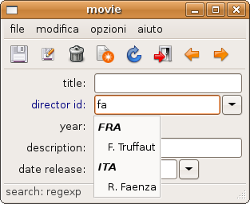

.. _completion:

============
Completion
============

Completion is the way you can avoid writing too much if the system already
has your data. it means you write some text that will be used as filter in a
select statements of all possible values.

This operation has 3 main actors: 

  1. the search field
  2. the operator used when searching
  3. the representation of the result

It comes in two *flavours*:

  1. completions on the same column (eg.: data that you have already written
     in other records). This is only available for char/text fields.

     No check is made in this field, the text can be further edited

  2. completion on foreign key. A check is made: there's no way to input a
     text that is not matched on the remote field (see :ref:`description`
     below). 

The match of the completion have two *modes*:

  :start: partially written text is used as a filter and completion must
    match from the start of the field. It uses LIKE operator

  :regexp: the match is done via regular expression if db supports it or via
    LIKE operator adding ``%`` on both sides

Since completion implies a search that may return *many* records, it's only
triggered on demand. Normal binding are:

  :shift   Return: triggers 'start' mode completion
  :control Return: triggers 'regexp' mode completion. This is also triggered 
                   pressing the down arrow of a foreign key

.. _description:

foreign key description & search field
======================================

A foreign key is substituted by a more descriptive text. Let's see how to
personalize it.

When completing a foreign key the completion puts in the EntryCompletion a
description of the foreign reference that can be customized via normal
python format strings. 

sqlkit.db.utils
----------------
You would use module sqlkit.db.utils and create an object TableDescr::

  from sqlkit.db.utils import TableDescr
  utils.TableDescr('movie', format='%(title)s - %(year)s', metadata=db.metadata)

metadata is necessary so that TableDescr knows where to go and autoload
Table to introspect it if you don't provide the search_field (see below)

_sqlkit_table
--------------
It's possible to write in the database the format string to be used in the
table. A table called ``_sqlkit_table`` is searched for. 

:search_field:
  The value of this field is used for the search. If no such field was
  defined, the first char field of the tale is used, if it exists.

:format: 
   the value of this field is used to represent the record

format and __str__
-------------------

When SqlWidget creates a class on the fly it looks for the 'format' field to
add a __str__ method to the class, so that this representation is used
whenever suitable (eg.: when a filter action is performed in a Mask)

behaviour on completion
========================

When the completion is in a SqlTable that represents an m2m relationship (as
``actors`` would be for ``movies``), the completion does not simply add the
single field but substitutes the whole record.

autocompletion
==============

You can force completion to start after n chars has been entered setting the
completion object ``autostart`` value::

  t = SqlMask(table='movie', dbproxy=db)
  t.completions.director_id.autostart = 2

Completion will be recalculated every time the written string is shorter that
the last text that triggered the completion.

Take care not to use a little value for ``autostart`` on large tables.

completion and Return in Tables
--------------------------------

There is another situation in which a completion is started
automatically. When editing a foreign key (or an m2m): if a ``Return`` is
hit, a select is issued to check if it's a valid value and if not that value
is used as base for completion. The difference from triggering a normal
completion is that if a valid value is found, no further completion is done.

.. warning::

  Since completion uses the already written chars to filter possible solution,
  if you further delete such chars you are not seeing all the real possible
  solutions but only the already retrieved ones. You can request a new
  completion... 

group_by
========

There is also en easy possibility to add grouping of completion via a
foreign_key attribute. It's enough to set the group_by attribute of
completion_group_by::

  t.completions.director_id.group_by = 'nation'

.. _`filter_completion`:

filtering completion
=====================

you can programmatically decide to filter what a completion returns in a
very easy way using :ref:`django like syntax <constraints>` (the same used
to set constraints)::

  t.completions.title.filter(title__icontains='love')

If ``t`` represents the SqlMask or SqlTable of a movie, this line will
instruct the completion to only show title that contains the world "love". 

Filters on a field that is a foreign key will be relative to the related
table::

  t.completions.director_id.filter(nationality='ITA')

will build a constraint on the **director** table filtering only italian
directors. 

.. note:: 

  filters on foreign keys are limited in the fact that they are built on a
  table (as opposed to built on a mapper) so that they know nothing on the
  relationship between tables and cannot span other relationships

dynamic filters
----------------

It's also possible to set a "dinamic filter" i.e. a filter depending on the
value already entered in another field::

  t.completions.last_name.filter(nation='$nation')

In this case the value of $nation will be set using ``t.get_value('nation')``
In case you have a related table you can go back to the main table::

  t.related.movie.completions.title.filter(director_id='$main.director_id)

  
