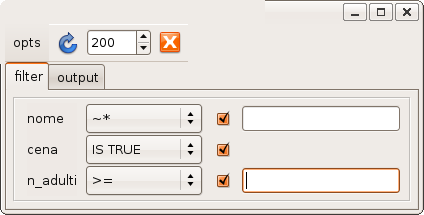
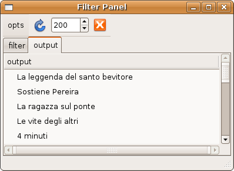

.. _filters:

=========
 Filters
=========

Filtering is a very powerful feature of sqlkit. Any single field in a
SqlWidget may become a filter criteria and many filters on a field are
accepted. A filter panel handle the filters that may also belong to related
table: in that case a join will be built when selecting (read the note on on
selecting throught joins in :ref:`relationships`)

As you can see in the image a filter panel gives also the opportunity to
limit the query. Any filter can be enabled or disabled by clicking on it's
toggle.

The result of a filter operation is shown differently in Table or Mask:
Table shows the result directly, Mask shows the list of selected records in
the Filter Panel's Output page:

Each record is shown with it's __str__ representation that can be set in the
ways described in :ref:`description`.

In this Output Page it's possible to set a field and have records grouped by
that field::

  t.filter_panel.tree = 'field_name'

Filtering Foreign Keys
======================

Filtering works also with foreign keys. In that case the filter acts on the
filter that represents the record, what I call the :ref:`"search"
<completion>` field of the record. In this case the operator used for the
search defaults to regexp/match that in turn uses different operators in
each database backend: '~*' for postgresql, REGEXP for mysql and ILIKE for
the others (well, ILIKE is not present in sqlite but it uses the sqlalchemy
implementation of ilike) adding leading and trailing '%' symbols.

Date filters
=============

Date filters deserve a special chapter. It's very common the need for a
filter based on relative dates (ie: the beginning of the month, the year,
the last month and so on), that's the only way to allow saving queries that
will behave the same all the time.

.. automodule:: sqlkit.misc.datetools

