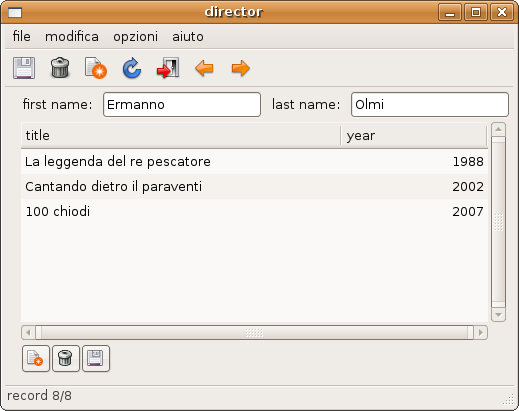
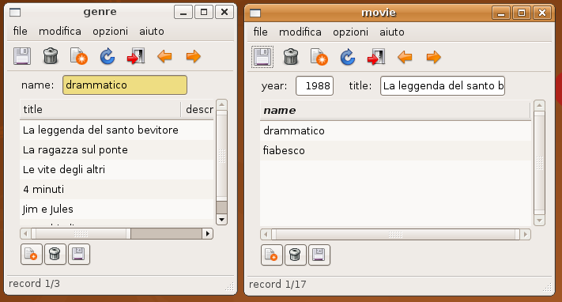

.. _relationships:

================
Relationships
================

Sqlkit makes editing of data that have relation as one2many of many2many
very simple. It's as easy as adding a field in the layout of the SqlMask.

One2Many in a SqlMak
=====================

This is a very powerfull feature of ``sqlkit`` that is built on top of
``sqlalchemy``'s mechanism of properties and session and on the ability of
``layout`` to let you define in a simbolic way a widget.

In the following example we will use a ``Mask`` to represent Directors 
and a ``Table`` to represent films, connected to the first by a OneToMany
relationship.

Suppose you already define a couple of tables in sqlalchemy, we will do it
using elixir_ that slightly simplyfies the syntax::

  class Director(elixir.Entity):
      last_name = elixir.Field(elixir.String(60))
      first_name = elixir.Field(elixir.String(60))
      movies = elixir.OneToMany('Movie', inverse='director', )
      elixir.using_options(tablename='director')
  
      def __repr__(self):
          return u'<Director: %s>' %self.last_name
  
  class Movie(elixir.Entity):
      title = elixir.Field(elixir.String(60))
      year = elixir.Field(elixir.Integer())
      director = elixir.ManyToOne('Director', inverse='movies' )
      elixir.using_options(tablename='movie')
  
      def __repr__(self):
          return u'<Movie: %s>' % self.title
  
To get a mask that:
 
 1. lets you see director and films toghether
 2. lets you edit them adding adn deleting at will

You just have to start te SqlMask like this::

  lay = """first_name last_name
         o2m=movies      - - -
         """
  SqlMask(mapper=Director.mapper, metadata=__metadata__, 
          session=elixir.session,layout=lay)

And you will get a mask that looks like this:

delete behaviour
----------------

We leave to sqlalchemy the responsability to decide if a film must be
deleted from the database or must just updated to set the director_id to NULL.
To change this behaviour you must act on the cascade property of the
relation (or directly on the database definition). If yo want to delete a
film in stead of just setting the property to NULL you can define the table
in this way::

  
  class Director(elixir.Entity):
      ...
      movies = elixir.OneToMany('Movie', inverse='director', 
               cascade="all, delete-orphan" ### note this line
		      )		
      ...
  

.. _elixir: http://elixir.ematia.de

Filtering
-----------

It is now possible to filter on a fields present in related tables, eg.:
filtering all films that have a certain genre.

Many2many relationship
=========================

many2many relationship are as easy as one2many. Once again sqlalchemy
does the heavy job. Definition is as simple as::

    lay = """year title
             m2m=genres - - -
             """
    tm = sqlkit.SqlMask(mapper=Movie.mapper, metadata=__metadata__, 
                        session=elixir.session,layout=lay)
    lay = """
         name 
         m2m=movies -
    """
    tm2 = sqlkit.SqlMask(mapper=Genre.mapper, metadata=__metadata__, 
                         session=elixir.session,layout=lay)
      

and will pop up a couple of windows as the following, showing the same data
from the two different main tables: movies with their genres and genres with
they're movies.

adding & completion
-------------------

When using :ref:`completion` in a m2m table, adding from completion behaves
differently that adding from m2o:

  1. it requires the field to be already present
  2. it complain if it cannot get one single element with that value 

Many2One or ForeigKey
======================

Many2One is a simpler case. The table we start from **has** a field that
holds a ForeignKey, we just need to follow it to know the value. This again
happens with no effort at all. In this case it's also possible to use this
field in a filter selection. 

Options 
==========

You can set the field_list directly from the layout as well as the number of 
rows::

   m2m=actors:5:first_name,last_name

will set a 5 rows table, and a field list of ``first_name``, ``last_name``.
The real dimension of the table depends also on the expand attributes of the
containers. you may need to set them to ``gtk.EXPAND|gtk.FILL`` by hand. 
There's an example that demonstrates it.

Behind the scenes
===================

The way sqlkit understands that ``movies`` is an entry point for a
relationship is that it analizes the ``mapper``, looks for a property with
that name and realizes that it's a PropertyLoader. That means that such an
entry point has been put there by a ``relation``. 

  

