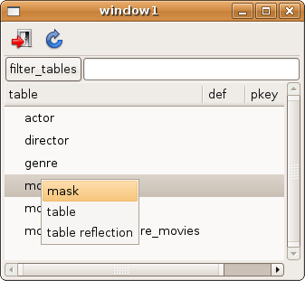
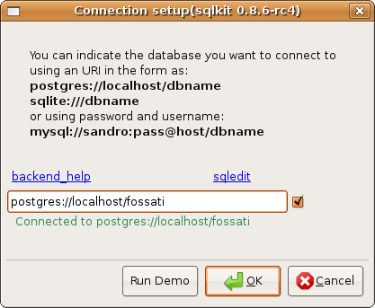
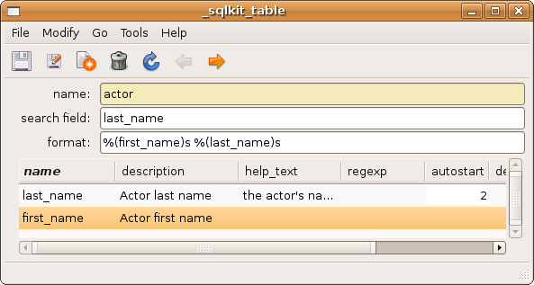

.. _sqledit:

==========================================================
 Sqledit - the standalone program to browse and edit data
==========================================================

Sqledit is a data editor/browser. It may be called on a database and it will
present a list of all tables that can be selected for editing (choosing 
:ref:`mask` or :ref:`table`) or for introspection.

It has several options:

.. docusage:: ../../bin/sqledit.py
   :verbatim:

If called without argument it will present a connection dialog:

If sqledit can find a demo in your systems, it will give you the chance to
start it. If you want to type the URL of your db you can directly attempt a
connection or disable it via a checkbox on the right of the entry.

The autoconnect mode is really nice but you may experiment hangs till a
connection timeout if you write a wong host name.

.sqledit
==========

You can write configurations in a file in your home called ``.sqledit/nicks`` and
start sqledit on that configuration using a nickname::

   [invitati]
   URL = postgres://sandro:xxx@my_host/2giugno
   table = partecipazioni_invitato
   dev = True
   field_list = nome, cognome, and all other fields
   order_by = cognome, nome

   [brasile]
   copy = invitati
   field_list = nome, cognome, email, ludo

  
Valid option are URL and any other option for sqledit. The special option
``copy`` force sqledit to read the other definition first and then
overwrite.
In this case 'brasile' shares all optioons with '2giugno'  but overwrites
field_list.

schema browser
==============

Introspection of the database will give you the possibility to see all
fields of a table showing all fields, with type, primary keys, foreign keys and
indexes.

Options
=======

When primary keys are numeric you probably don't want/need to see them, you
can switch off the visualization with the ``primary key`` togle button

The ``Load`` toggle button determines if you want to load data when opening a
table. 

``Blank`` toggle button determines if you want to cast blank string fields to
NULL values. When you decide to cast it you may be prompted several times if
you want to save changes that you are not even aware of.

Configuring sqlkit
==================

Sqlkit looks for possible configuration options in some tables, that may or
not be present: _sqlkit_table, and _sqlkit_field.

These tables can be edited directly from the database menu, or via
``<Ctrl-e>`` shortcut.

Completion will help yo configure the fields. Here is the meaning:

table's field
-------------

:name: the table's name 

:search field: this is the **string** field that will be used when searching
   via foreign key. Suppose you are editing a table of movies, and you must
   fill in the director's field. You write some letters and trigger a
   completion, that means you want sqlkit to use that text (eg. "Fel"), 
   select which directors are present that has that string in... well you
   surely want to search in the last name, but you need to tell sqlkit.

   *search_field* is here for that.

:format: ok, you have back from completion a list of directors you still
   need to show them in a nice way (e.g. first_name, last_name). Here you
   are supposed to used the syntax "%(field_name)s".

attributes'fields
-----------------

:name: the field_name

:description:  the lable you want to be used. (Note that when using
   :ref:`related tables <relationships>`  you may indicate
   relation.field_name)

:help_text: this is the ooltip that will be added to the entry

:autostart: you can set an :ref:`autostart` value for the completion

