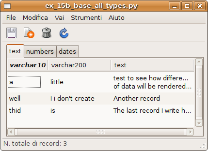

.. _table:

===========
 SqlTables
===========

SqlTable is a widget that represent data in a table mode. Columns that are
foreign keys are presented in blue and a :ref:`description` of
the foreign key is used.

.. autoclass:: sqlkit.widgets.SqlTable(see_below)
   :members: create_view, set_field_list, set_editable, set_opts, add_record

Attributes
==========

.. attribute:: totals

   class for :ref:`totals`: see the specific documentation for further info

.. image:: ../img/menu.png
   :align: right

Column headers
==============

Each column is clickable. Clicking on the column pops up a menu that enables:

 - to add a filter on this field (see :ref:`filters`). This same action can
   be done by pressing ``f`` on the column w/o opening the column menu.

 - to sort on this field (database sorting). Note that sorting on a
   ForeignKey will trigger a join with the referenced table and an attempt
   to sort on the :ref:`description` (In general you don't want to
   sort on the ``id``). 

   A "local sort", i.e. a sort done without hitting the database is
   performed when you sort a related table (e.g.: as explained in
   :ref:`relationships`) or when you press ``s`` on a column after clicking
   the table (to set the *focus* on the table)

 - to add a total on this column (if the column is numeric). This same action can
   be done by pressing ``t`` on the column w/o opening the column menu.

 - to add a brake on this column (see docs for :ref:`totals`). This same action can
   be done by pressing ``b`` on the column w/o opening the column menu.

 - to hide a column. This same action can
   be done by pressing ``h`` on the column w/o opening the column menu.

Cell renderers
==============

Boolean
---------

Booleans are represented with CellRendererToggle, if the field is nullable,
the value loops over 3 states.

Text
----

I don't have a satisfactory CellRender for long text. Any hint is appreciated.

Export
=======

A very minimal export function allows to export visible data in a csv (comma
separated value) format. Follow File -> Export.

Shortcut
========

in the treeeview
----------------

:Control-x:  eliminates a line
:Control-k:  eliminates a line 
:Control-s:  saves the record
:Control-q:  quits the table
:Control-n:  opens a new record
:s:  sorts the table locally (toggle between scending and descending)
:f:  open a filter for this column
:t:  create a total if the column is numeric
:b:  add a break for totals on this column. In addition to this operation it
     also sort on the column as it often happens you want a subtotal after
     having ordered. Adding a break from the column menu does not order.

in the editable cell
--------------------
:Control-Enter: pops a completion (regexp mode)
:Shift-Enter:   pops a completion (start mode)
:Esc:           aborts editing 

Signals
=======

:button-press-event: this event is emitted when clicking in the treeview if
       there are no pending validation errors (in which case you are forced
       to solve them before). It is mainly used to handle the default
       menu. Look in the example to see how you can manipulate the menu.

  .. method:: button_press_cb(table, event, obj, field_name, menu, treeview)
 
     :param table: the SqlTable that emitted the signal
     :param event: the gtk.gdk.Event associated
     :param obj: the object currently selected or None
     :param field_name: the field_name of the selected column
     :param menu: the default menu that il popped up by this
          button-press-event if event.button == 3 or None
     :param treeview: the TreeView widget that was clicked. You may get the
          view the treeview belongs to with ``treeview.get_data('view')``

          .. versionadded:: 8.7

.. _context_changed:     

:context-changed:

   Records have been displayed or selection was changed. 
   This is used to track any change in the records both selected or displayed
   and was added to be used by RecordInMask below
   
   .. function:: records_displayed_cb(sqlwidget, current):
      
      :param sqlwidget: the widget the emitted the signal
      :param current: the obj that was current in the row or the first
             record in the liststore.

.. _recordinmask:

RecordInMask
============

Clicking on any row of the treeview gives the possibility to show the record
in a Mask View. If a layout was passed to the ``SqlTable``, it will be
passed to SqlMask. In this case all hooks, fields possibly configured
and completions will be copied in the new Mask. Same for the hooks.

If you need to configure this Mask in a particular fashion you can put all
configuration in a hook named :ref:`on_init <hooks>`. This code will be executed
both for Table and Mask generation that allows to use the same Hook for both
widgets

RecordInMask for ForeignKeys
============================

Similarly, if the column in which you click is a ForeignKey, the popped menu
will show an entry to edit the referenced record in a mask.

To be sure it will have the customization you want you can 
:ref:`register <utils>` Layout, Hooks and Class.

In the case you have several possible layout for the same fk, and you want
to use a layout that is not the default one, you can use ``set_fk_layout``

.. _views:

Views
=====

Views (added in rel 0.8.8) are a way to view the same data in two different
TreeViews.  This way you can split a very large table into different chunks
(vertically), leaving some columns to a view and others to a different
view. The same column may be repeated in different view.

   An example of a table with views: *numbers* and *dates* are really fields
   of the same table

Sorting columns
===============

Sorting columns can be done in 2 different ways:

#. using :attr:`sqlkit.widgets.common.SqlWidget.order_by` attribute of sqlwidget, that triggers an
   ``ORDER BY`` clause on the database

#. using ``order_by`` clause of ``modelproxy``, that triggers a function
   locally. This option is faster since you don't need to reload data

   This is the only method you can use to order related table, apart from
   playing with relation's order_by attribute in the model

   Currently it can be done:

   :programmatically: 
      by ``modelproxy.order_by`` with argument a string with field_names possibly
      prefixed by + or - to define the order::

	t = SqlTable(...)
	t.modelproxy.order_by('status -description')

      it can also be used to order a related table::

        lay = """
             director
             o2m=movies
        """
	m = SqlMask(..., layout=layout)
	m.related.movies.modelproxy.order_by('-year title')

      when sorting a field that represent a foreign key, the value of the
      lookup (i.e.: the value shown) is used rather than the value of the key

    :interactively: currently limited to just one column at a time pressing
        ``s`` when **focus in in the treeview** (i.e. you ave already
        clicked the treeview). Sorting will toggle ascending and descending.

