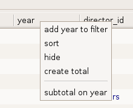

.. _table:

===========
 SqlTables
===========

SqlTable is a widget that represent data in a table mode. Columns that are
foreign keys are presented in blue and a :ref:`description <description>` of
the foreign key is used.

Options
=======

.. class:: sqlkit.widgets.SqlTable(same options as sqlwidget + listed below)

  :param rows:  how many rows should be initially allocated space for

Attributes
==========

.. attribute:: totals

   class for :ref:`totals`: see the specific documentation for further info

Methods
=======

.. method:: set_opts(scroll=None, icons=True)

   :param scroll: eliminate scrollbars (values: x|y|xy|None)

   :param icons: allows to disable icons in a m2m relationship
   :type scroll: boolean 
   

.. method:: set_editable(editable)

   :param editable: Only meaningful for table that represent an
          m2m relationship: turns the table from non editable to editable, 
	  read the explanation in :ref:`relationships`
   :type editable: boolean

.. method:: hide_fields(field_list)

   :param field_list:  hides columns, adding a row in the menu to make it
          show up again at will 
   
.. method:: select_path(path=None, obj=None)

   :param path:  the path to be selected or None
   :param obj:  if path is None, the object to be searched for and selected

.. method:: set_fk_layout(field_name, layout_nick)
   
   :param field_name:  the field_name to set a foreign layout for
   :param layout_nick:  the nick to use

   used to set a layout to be used if opening a mask to edit the foreign key

Column headers
==============

Each column is clickable. Clicking on the column pops up a menu that enables:

 - to add a filter on this field (see :ref:`filters`)
 - to sort on this field (database sorting)
 - to add a total on this column (if the column is numeric)
 - to add a brake on this column (see docs for :ref:`totals`)

Cell renderers
==============

Boolean
---------

Booleans are represented with CellRendererToggle, if the field is nullable,
the value loops over 3 states.

Text
----

I don't have a satisfactory CellRender for long text. Any hint is appreciated.

Export
=======

A very minimal export function allows to export visible data in a csv (comma
separated value) format. Follow File -> Export.

Shortcut
========

in the treeeview
----------------

:Control-x:  eliminates a line
:Control-k:  eliminates a line 
:Control-s:  saves the record
:Control-q:  quits the table
:Control-n:  opens a new record

in the editable cell
--------------------
:Control-Enter: pops a completion (regexp mode)
:Shift-Enter:   pops a completion (start mode)
:Esc:           aborts editing 

Signals
=======

:button-press-event: this event is emitted when clicking in the treeview if
       there are no pending validation errors (in which case you are forced
       to solve them before). It is mainly used to handle the default
       menu. Look in the example to see how you can manipulate the menu.

  .. method:: button_press_cb(table, event, obj, field_name, menu)
 
     :param table: the SqlTable that emitted the signal
     :param event: the gtk.gdk.Event associated
     :param obj: the object currently selected or None
     :param field_name: the field_name of the selected column
     :param menu: the default menu that il popped up by this
          button-press-event if event.button == 3 or None

.. _context_changed:     

:context-changed:

   Records have been displayed or selection was changed. 
   This is use to track any change in the records both selected or displayed
   and was added to be used by RecordInMask below
   
   .. function:: records_displayed_cb(sqlwidget, current):
      
      :param sqlwidget: the widget the emitted the signal
      :param current: the obj that was current in the row or the first
             record in the liststore.

.. _recordinmask:

RecordInMask
============

Clicking on any row of the treeview gives the possibility to show the record
in a Mask View. If a layout was passed to the ``SqlTable``, it will be
passed to SqlMask. In this case all hooks, fields possibly configured
and completions will be copied in the new Mask. Same for the hooks.

If you need to configure this Mask in a particular fashion you can put all
configuration in a hook named :ref:`on_init <hooks>`. This code will be executed
both for Table and Mask generation that allows to use the same Hook for both
widgets

RecordInMask for ForeignKeys
============================

Similarly, if the column in which you click is a ForeignKey, the popped menu
will show an entry to edit the referenced record in a mask.

To be sure it will have the customization you want you can 
:ref:`register <utils>` Layout, Hooks and Class.

In the case you have several possible layout for the same fk, and you want
to use a layout that is not the default one, you can use ``set_fk_layout``

