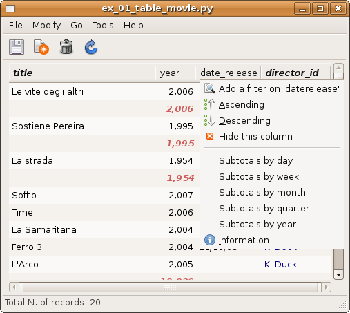

.. _totals:

========
 Totals
========

Numeric columns of a Table have the option to show totals and
subtotals. Subtotals are determined by brake fields/functions. This may be
done interactively from the column menu or from code. The following example
is very stupid but... you get the feeling!::

    t = SqlTable('movie', dbproxy=db, order_by='director_id')
    t.totals.add_break('director_id')
    t.totals.add_total('year')

Fixed footer
============

With many rows the grand total, being the last row of the table, is out of
sight. For this reason grand totals are also shown in a fixed strip right
under the table, always visible, each one under its own column. The strip
follows the width, visibility and order of the columns and the horizontal
scroll of the table. Columns with a total are widened, if needed, so that the
total is not clipped.

When the grand total row of the table is entirely in sight (few rows, e.g.
the inline table of a record, or a table scrolled to the bottom) the strip
becomes transparent, so the total is not shown twice. Its space stays
reserved: the table does not change height while scrolling.

The strip is hidden when no total is defined or when ``hide_total`` is used.
To disable it set ``footer`` to False before adding totals::

    t.totals.footer = False
    t.totals.add_total('year')

The strip is implemented by
:class:`sqlkit.widgets.table.totals_footer.TotalsFooter` and can be replaced
setting ``footer_class`` on the Totals instance.

Personalization and colors
==========================

Totals are generated by a class ``sqlkit.widgets.table.totals.Totals`` that
can be inherited and modified to set different total behavior.

The colors are defined in a class in the same module ``TotalObj`` whose
method ``set_value_and_colors`` can be used to personalize colors and markup
of the cell.

Dates
=====

Since date breaks are probably very common a function makes it easy to
brake on dates.

Totals... with no totals!
=========================

If you only need subtotals and not totals you can prevent totals using
option ``hide_total`` when declaring the column to sum.

Signals
=======

:computed: this signal is emitted when the total is computed. The signature
           of the callback function is:
       
      .. function:: computed_cb(total):
      
         :param sqlwidget: the total instance that emitted the signal

API
---

.. automodule:: sqlkit.widgets.table.totals

.. automodule:: sqlkit.widgets.table.totals_footer

.. autoclass:: sqlkit.widgets.table.totals_footer.TotalsFooter
   :members: refresh, fit_widths, rebuild

   
